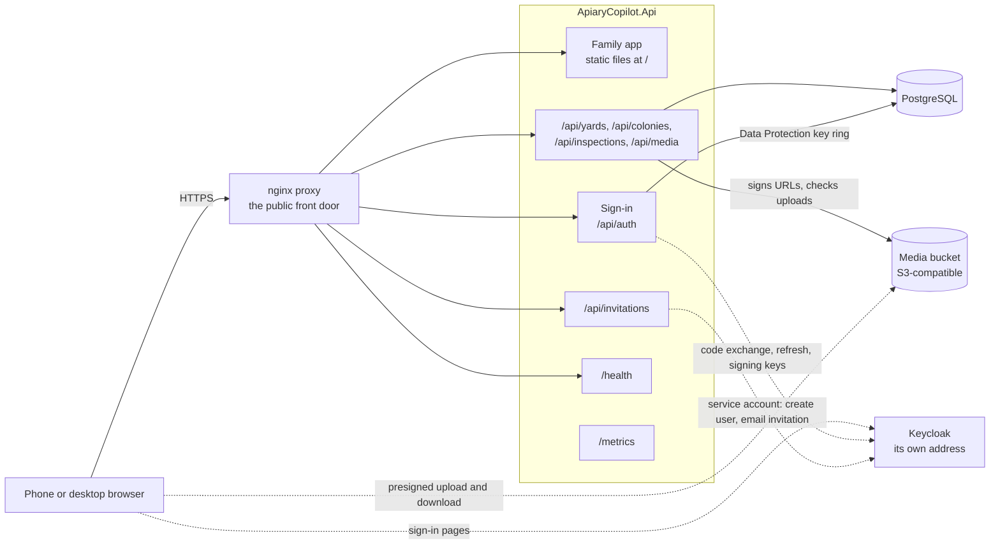
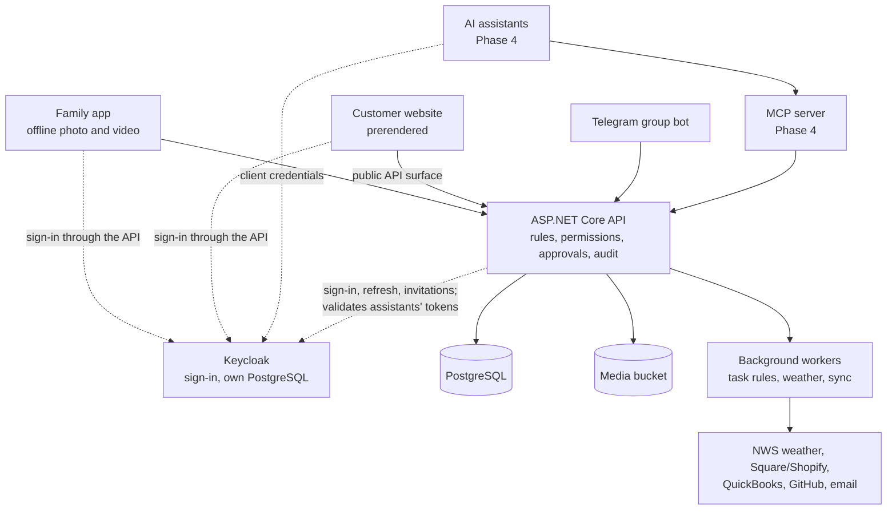

# Architecture

How Apiary-Keeper is put together: what runs today, the plan it is growing into, and the design decisions behind
both. Decisions carry an ID (`D-n`) that the code's comments cite.

## What runs today

One ASP.NET Core server behind an nginx reverse proxy, with PostgreSQL for records, an S3-compatible bucket for
photos and video, and Keycloak for sign-in. The server also serves the family app as static files. Nothing is
deployed yet; locally, `compose.yaml` runs all of it on `127.0.0.1`.

- **The proxy** (`proxy/`) is the public front door to the server, which has no public address of its own. It
  routes the app's host names to the server over a private network, sets the security headers, limits request size,
  and refuses `/metrics` from outside. On staging, until sign-in is set up there, it also asks for a shared password on
  every path but `/health` (D-16).
- **The server** (`src/ApiaryCopilot.Api/`) answers `/health` with its version, serves the API under `/api`, exposes
  Prometheus metrics at `/metrics` for scraping on the private network, publishes an OpenAPI description in
  Development, and serves the built family app from `/`. It trusts the proxy's forwarded headers only from a peer on a
  private network.
- **Photos and video never pass through the server.** The app asks the server for a short-lived presigned URL, uploads
  the file straight to the bucket, then tells the server to attach it; the server checks with the bucket what was
  stored. Downloads work the same way (D-13).
- **Sign-in is inside the server** (D-19). The server signs a browser in through Keycloak under `/api/auth` (OpenID
  Connect, the authorization code flow with PKCE, as a confidential client) and leaves the browser only a cookie that
  names a session held in the server's memory. An automated client sends a Keycloak-issued bearer token instead. Both
  give the same principal: the user's Keycloak subject (`sub`), its one account (`account_id`) and its role. The server
  renews a session's short-lived access token itself, with a refresh token it keeps server-side, so a role change
  reaches the user without signing out and a disabled user is cut off at the next renewal; sign-out also ends the
  Keycloak session. A write that carries the session cookie must carry the header `X-CSRF: 1`. The Data Protection
  keys that protect the cookie are kept in PostgreSQL, encrypted with a certificate from the environment. Sign-in
  exists only where `SignIn__Authority` is set.
- **Who may call.** Every yard, colony, inspection and media request needs a signed-in `owner` or `helper`. It acts
  for the account in the caller's token, as the user of that account whose `ExternalSubject` is the token's `sub`.
  Not signed in is `401`; a `grower` or `customer`, an account with no row, or a subject no user of the account holds is
  `403`; with sign-in off no caller has an account, so every such request answers `503`. In each case nothing is read
  or written. A found user is trusted for 30 seconds and a refusal is never remembered, so a user added later is served
  without a restart.
- **Invitations.** An owner invites a helper or a grower by email (`POST /api/invitations`). The server, as its own
  Keycloak service account, creates the user with the owner's `account_id` and the role, has Keycloak email the
  invitation, and writes the user's row with the new Keycloak user id as its `ExternalSubject`, so the user acts as
  that row from the first sign-in (D-22). An owner is created by the Keycloak administrator, never by the server.
  Invitations exist only where `KeycloakAdmin__ClientId` is set; elsewhere the endpoint answers `503`.
- **The family app** (`src/pwa/`) is a React, TypeScript and Material UI app built with Vite, installable on a phone's
  home screen (a web app manifest and a service worker that caches the app's shell; no offline data yet). Its screens
  live in the URL fragment (`/#/yards/…`), so every screen is served from `/` (D-20). It talks to the server only over
  HTTP, under `/api` on its own origin, and sends `X-CSRF: 1` on every write. It has no sign-in screen yet: a user
  signs in by opening `/api/auth/login`, and the app shows a `401` as the server being unreachable.

## The API

| Endpoint | Does |
|---|---|
| `GET /health` | The running version, `{"version":"X.Y.Z"}`; anonymous |
| `GET /api/auth/login`, `GET /api/auth/callback`, `POST /api/auth/logout`, `GET /api/auth/me` | Sign a browser in, finish the sign-in, sign out, and read the caller's principal; only where sign-in is on |
| `POST /api/invitations` | An owner invites a helper or grower by email |
| `POST /api/yards`, `GET /api/yards`, `GET /api/yards/{id}`, `PUT /api/yards/{id}` | Create, list (paged, by name), read and update a yard with its landowner |
| `POST /api/colonies`, `POST /api/colonies/swarm-captures` | Register a colony, or a captured swarm |
| `POST /api/colonies/{id}/splits`, `/merges`, `/requeens`, `/moves` | Record a split, merge, requeen or move; each is appended to the colony's history |
| `GET /api/colonies`, `GET /api/colonies/{id}`, `/events`, `/queens` | List and read colonies, their history and their queens |
| `POST /api/colonies/{id}/inspections`, `GET` the same | Record an inspection; list a colony's inspections, newest first |
| `GET /api/inspections/{id}` | Read one inspection |
| `POST /api/inspections/{id}/media/uploads` | Get a presigned upload URL for a photo or video |
| `POST /api/inspections/{id}/media`, `GET` the same | Attach an uploaded file; list an inspection's media |
| `GET /api/media/{id}` | Read one media item, with a fresh presigned download URL |

Nothing updates or deletes a colony event, an inspection or a media item: they are recorded once. Invalid input is
answered with `400` and a problem description naming each field; a write that lost a race to another answers `503`
and may be retried; a change the server accepted with a caveat (a requeen dated before the current queen's
introduction, say) returns it as `warnings` on the result. The full contract is in [`INTERFACES.md`](INTERFACES.md).

## Projects and how they depend on one another

| Project | Holds |
|---|---|
| `ApiaryCopilot.Api` | The host: endpoints, request parsing and validation, sign-in and its session renewal, the signed-in account and acting user, the invitation endpoint and its Keycloak admin client, forwarded headers from the proxy, serving the family app |
| `ApiaryCopilot.Domain` | The records and rules: accounts and users, yards, colonies with their queens and append-only events and the projection that folds events into current state, inspections with the one catalogue of inspection fields, and media keys. References nothing |
| `ApiaryCopilot.Infrastructure` | EF Core on PostgreSQL: the database context, the account filter on every query, the row stamps, the migrations, the stores for each record and for users, the Data Protection key store, and the S3 client for the media bucket |
| `pwa` (`src/pwa/`) | The family app; not part of the .NET solution, built separately and copied into the server's image |
| `ApiaryCopilot.UnitTests`, `ApiaryCopilot.IntegrationTests` | The two test tiers (below) |

Dependencies point inward: `Api → Infrastructure → Domain`. The domain references nothing, and the infrastructure
library references neither the host nor ASP.NET Core, so business rules stay independent of the transport (D-1).

## Data

**The account is the root** (D-8). An account is one apiary; every record carries its account, and EF Core filters
every query to the current account — with no account, a query returns nothing. A user belongs to one account.

**Every record is stamped** with who created it and who last changed it (user IDs) and when (UTC), set on every save.
A save with no current user writes nothing.

| Table | Holds |
|---|---|
| `Accounts`, `Users` | The apiary, and the people who act for it. A user's `ExternalSubject` is its Keycloak subject (`sub`, never the email): optional, and unique across every account |
| `Yards` | Each yard and its landowner arrangement |
| `ColonyEvents` | The append-only lineage history: registered, swarm capture, split, merge, requeen, move. A database trigger refuses any update, delete or truncate |
| `Colonies`, `Queens` | Each colony's and queen's current state, projected from the events (D-2) |
| `Inspections` | Each inspection: the day, when it was recorded, notes, and the findings in one `jsonb` column |
| `InspectionMedia` | The bucket objects attached to each inspection, by key `accounts/{account}/inspections/{inspection}/{random token}` |
| `DataProtectionKeys` | The server's Data Protection key ring, each key encrypted with the certificate from `DataProtection__Certificate`; outside the account filter, read and written only by the server |

**The inspection fields live in one place**, the `InspectionFields` catalogue in the domain. To add, change or remove
a field, edit that list: validation, storage, the order findings are returned in and the API's published description
follow it, and no migration is needed because the findings are one `jsonb` column.

Planned, not built: treatments, tasks, harvests and lots, inventory, customers and orders, pollination contracts and
placements, feedback, assistant proposals and an audit log.

## Tests

- **Unit tests** (`ApiaryCopilot.UnitTests`, xUnit) run in memory: the domain rules, each endpoint through the real
  host with its store faked, account isolation over every table, the row stamps, sign-in (the cookie session, the
  bearer path and the tokens it refuses, the CSRF check, the renewal, the authorization of every request group), the
  media settings and signed URLs, and checks that no diagnostic output carries a URL, key or bucket credential. They
  also run inside the image build.
- **Integration tests** (`ApiaryCopilot.IntegrationTests`) start a throwaway PostgreSQL, MinIO and Keycloak (with the
  invented realm from `keycloak/import/`) in Docker, migrate and seed the database with invented accounts, start the
  server (from source by default, or any image through the `APP_SERVER_COMMAND` variable) with sign-in on, and drive
  it over HTTP as the realm's invented owner: yards, colonies (including races and the append-only trigger),
  inspections, media uploads straight to the bucket, who may call each request, and that one account never sees
  another's data. Others sign a browser in through Keycloak's own login form, renew and end sessions, check what the
  Keycloak service account may and may not do, and invite a helper end to end through a local Mailpit.
- **The family app's tests** (Vitest and Testing Library) sit beside its code; they include the theme's contrast.
- **The proxy's tests** run in its image's `test` stage; the deployment, migration and rollback-check scripts have
  tests in `scripts/tests/`.

## Images

| Image | Built from | Runs on | Port |
|---|---|---|---|
| The server, with the family app inside | `Dockerfile` — its `pwa` stage builds the app with Node.js 24 | `mcr.microsoft.com/dotnet/aspnet:10.0`, as its non-root user | 8080 |
| The proxy | `proxy/Dockerfile`, context `proxy/` | `nginx-unprivileged`, as a non-root user | 8080, and 9113 for its own metrics |

They are published as `ghcr.io/<owner>/apiary-keeper` and `ghcr.io/<owner>/apiary-keeper-proxy`, `<owner>` being the
lower-case name of the GitHub account or organisation that owns the repository. Both packages are kept **private**:
Railway pulls them with registry credentials. Both images carry the one version from `Directory.Build.props` and are
tagged by it (`:X.Y.Z`), never by a commit hash. Keycloak is not built here: it runs from Keycloak's own image. How
the images are deployed is in [`DEPLOYMENT.md`](DEPLOYMENT.md).

## The plan it is growing into

Mostly not built yet. One API serves every client; rules, validation and permissions are enforced there, and
**assistants never touch the database**.

- **Hosting:** Railway, with `staging` and `production` environments, each running the proxy in front of one `app`
  service (the API, the static apps, the workers and the chat webhook), PostgreSQL and a bucket, and from Phase 1 a
  Keycloak service with its own database (D-5, D-19).
- **Addresses:** staging at `staging-apiary-keeper.marqspec.com`, production at `apiary-keeper.marqspec.com`, both on
  the proxy. These are interim names: the go-live domain is `apiary-keeper.com`, with per-customer storefronts at
  `{business name}.apiary-keeper.com` (D-17). Keycloak has its own Railway-assigned address, not behind the proxy
  (D-19), and the proposal page its own as well.
- **Sign-in on the deployed environments (Phase 1):** Keycloak, with email and password or Google, invited users only,
  MFA the owner may require. The server side described above is built; standing Keycloak up on Railway and turning
  sign-in on there is still to do. Sessions are held in memory, so the server runs as one replica and a restart signs
  users in again, usually with a quick redirect.
- **Roles and accounts:** one Keycloak realm with the roles `owner`, `helper`, `grower` and `customer`; the token
  carries the role and a single `account_id`, since a user belongs to one account. Invitations and customer accounts
  go through the API's Keycloak service account; an `owner`, a new apiary account, is created by the Keycloak
  administrator (D-22).
- **Customer website (Phase 2):** a separate prerendered React app on its own domain, calling a public API surface
  that is rate-limited and accepts requests only from the site's domain (D-6); payment through hosted checkout (D-7).
- **Assistants (Phase 4):** reach the data only through an MCP server that shares the API's rules; each is its own
  Keycloak client with its own scopes; their writes are proposals a person approves unless a tool is explicitly
  allowed to commit, and anything touching money, sales or regulatory data needs approval (D-12).

## Decisions

| ID | Decision | Why, and what was rejected |
|---|---|---|
| D-1 | One .NET solution, `src/ApiaryCopilot.slnx`; hosts reference libraries, never the reverse | Business rules stay independent of the transport |
| D-2 | ASP.NET Core minimal APIs, EF Core and PostgreSQL; colony history in an append-only event table, with current state projected from it; workers as `BackgroundService` (Hangfire still open) | A mutable colony table would lose lineage |
| D-3 | Telegram for the family chat, behind one channel interface; video goes through the app's upload path | Discord's minimum age and upload limits; Slack and Signal kept as alternates |
| D-4 | One installable web app for phone and desktop; no native iPhone app | Capacitor, React Native and .NET MAUI cost Apple fees, and the last two a second codebase; Capacitor is revisited only if field tests lose media |
| D-5 | Railway (the Pro plan, D-23): one project, `production` and `staging`; one `app` container plus PostgreSQL and a bucket | A service per component costs more memory, Railway's main cost |
| D-6 | The customer website is a separate prerendered app, served as static files from the same `app` service on its own domain, calling a separate public API surface | A separate hosting service costs more |
| D-7 | Payment is handed to Square or Shopify hosted checkout | Taking cards directly would bring PCI scope |
| D-8 | The account (one apiary) is the root: every record carries its account, every query is filtered to it, media paths are prefixed by it; the screens show one account. There is no organization or co-op above it | A single-tenant schema would need a rewrite if other apiaries adopt it |
| D-9 | ASP.NET Core Identity for sign-in | **Superseded by D-19** |
| D-10 | Optional modules behind Microsoft.FeatureManagement: per deployment first, per account later; checked by the server, a hidden module answers 404 | Client-only switches can be bypassed |
| D-11 | In-app feedback becomes a GitHub issue through a server-side credential, with a copy in the database | A separate helpdesk tool is another account and cost |
| D-12 | Assistants reach the domain only through an MCP server; writes are proposals unless a tool may commit; the AI model is pay-per-use and provider-agnostic | Rules inside the assistant could be bypassed |
| D-13 | Phones upload and download media directly from the bucket on short-lived presigned URLs | Streaming through the API costs memory and bandwidth |
| D-14 | Material UI with a Material 3 palette from the honey seed `#E8A33D`, light and dark | — |
| D-15 | Each image is built once, tested, deployed to staging, and the same image is promoted unchanged to production | Building per branch would put an untested build in production |
| D-16 | An nginx reverse proxy, built here, is each environment's public front door to the app, so later services can sit behind it too; the proposal page and Keycloak have addresses of their own | Routing each domain straight to the app would give every new service its own exposure |
| D-17 | Staging is `staging-apiary-keeper.marqspec.com` and production `apiary-keeper.marqspec.com`, interim names; the go-live domain is `apiary-keeper.com`, with per-customer storefronts at `{business name}.apiary-keeper.com` | A business domain now: none is chosen yet |
| D-18 | Until sign-in existed, the account and the acting user came from configuration (`CurrentAccount__Id`, `CurrentUser__Id`). **Retired**: the server reads neither setting any more; the account and the user come only from the signed-in caller (D-19) | A stopgap so the prototype could be shown before sign-in was built |
| D-19 | Keycloak is the identity provider: OpenID Connect sign-in; email and password or Google; invited users only; per-user MFA; no sign-in for children under 13. Keycloak runs on its own Railway-assigned address, which is the token issuer and must stay stable. A backend-for-frontend inside the API signs browsers in and keeps the refresh token server-side, renewing the session with its own code (an access token of about 5 minutes, a 30-minute idle timeout, a 12-hour maximum session, refresh-token rotation on — settings, not constants); a browser is authorized on the cookie session's claims (`sub`, `account_id`, roles), an assistant on a bearer access token the API validates (RS256, issuer, audience, lifetime). The acting user is the user whose `ExternalSubject` is the token's `sub`. Sessions in memory; the Data Protection keys in PostgreSQL, encrypted with a certificate from the environment | ASP.NET Core Identity issues no scoped tokens for assistants; Duende IdentityServer and its token library are commercially licensed; a separate BFF service or YARP costs another service; Redis for sessions is not needed at one replica. Accepted cost: a Java service and its database to run |
| D-20 | The family app's screens live in the URL fragment, so no server path falls back to `index.html` and an unknown path stays a 404 | Path routes would need a server-side fallback list kept in step with the screens |
| D-21 | Staging's schema is changed by a generated SQL script, run before the new image is deployed; migrations only add; rollback is by image, never by a down migration | A startup migration would need schema rights and slow the health check; a down migration loses data |
| D-22 | Keycloak's roles are realm roles in one realm (`owner`, `helper`, `grower`, `customer`); the token carries the role and a single `account_id` claim, in the ID token and the access token; one account per user. The API's Keycloak service account creates users as `helper`, `grower` or `customer` and sends their invitation; an `owner` is created by the Keycloak administrator, and holds `owner` only through the `owners` group, never by a direct role mapping. The service account's grant (Keycloak's fine-grained admin permissions): `manage` and `map-roles` on users, `map-role` on the three member roles, and a deny on the `owners` group's members — so it cannot give or take `owner`, read users or credentials, change roles, clients or the realm, impersonate, or disable, edit, reset, email or delete an owner. **Accepted wider reach:** the `manage` that creating needs also lets it edit, disable, delete, reset or email any user outside the `owners` group, and add or remove a member role on any user, owners included — so a leaked secret could take over any helper, grower or customer in any account; the secret's custody and rotation are the control. The owner never sees the Keycloak console; a sealed second administrator login is the recovery path; a password-reset link lasts 30 minutes | Roles per account, needed only if a user could belong to several; a role lookup per request, a second source of truth; a service account that could create an `owner`; Keycloak's full `manage-users`, which could also take over owners; a Keycloak extension exposing only the narrow operations, which would add a custom Keycloak image to build and upgrade |
| D-23 | Railway's Pro plan ($20 a month, including $20 of usage; usage above it billed at the same rates). The two images' packages stay private, and Railway pulls them with registry credentials, which Pro allows; nothing is ever pushed public. The proposed cost ceiling is NFR-7's | Hobby with public packages would let anyone download the compiled server, which decompiles to near-source |

Open on D-22: changes to an existing user — its role, requiring MFA for it, a helper's finer permissions, re-enabling
it, correcting its `account_id` — are not in the service account's set, so only a Keycloak administrator can make
them for now; and how an administrator-created owner fits FR-74's wording (the owner invites family members and
assigns each a role) and the production bootstrap step is still to be settled.
